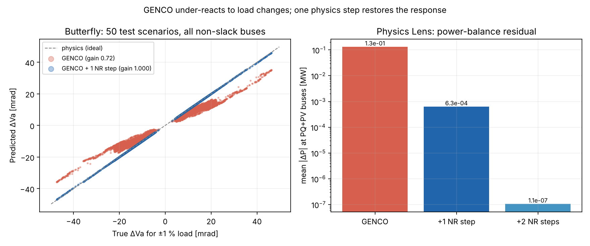
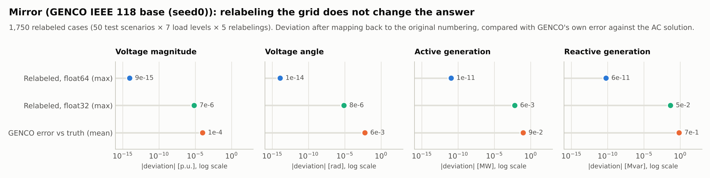
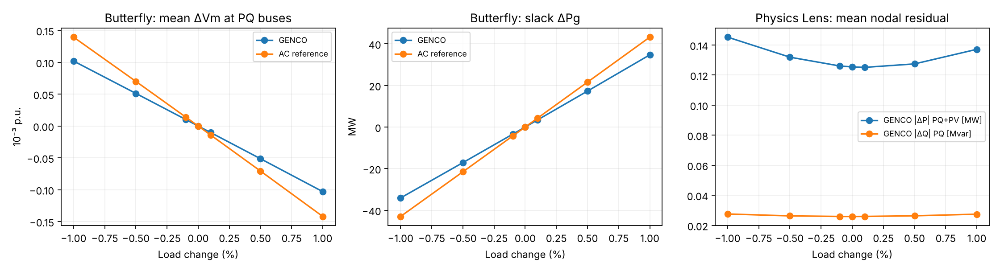

# GRID MIRAGE

**Same physics. Different representation. Different predictions?**

An entry to the [GridFM GENCO Challenge](https://huggingface.co/spaces/gridfm/genco-challenge). It runs a three-part metamorphic test, plus a hybrid fix, of the pretrained GENCO power-flow model [`gridfm/genco-pf-datakit`](https://huggingface.co/gridfm/genco-pf-datakit) (IEEE 118, base, seed 0) using the official [GraphKit](https://github.com/gridfm/gridfm-graphkit) pipeline. The test uses 50 scenarios from the official held-out test split of [`gridfm/pf_small_case118_ieee`](https://huggingface.co/datasets/gridfm/pf_small_case118_ieee), plus an independent 8-scenario pilot.

| Test | Question | Result |
|---|---|---|
| **Mirror** | Same grid, buses/generators/branches relabeled: same prediction? | Yes, equivariant: ≤1.2e-14 in float64. The float32 spread (≤8e-6 p.u.) is summation-order round-off. |
| **Butterfly** | ±0.1…±1 % demand change: does GENCO respond like the physics? | **Attenuated in 50/50 scenarios:** Vm 0.786× (95 % CI 0.761–0.809), Va 0.718× (0.701–0.735), slack ΔPg 0.800× (0.786–0.814) of an exact AC solution. |
| **Physics Lens** | AC power-balance residual of the predictions (only on quantities not enforced by construction) | 0.125 MW mean at the dataset point (CI contains the published 0.106 MW), rising to 0.137–0.145 MW at ±1 % load. |
| **Hybrid fix** | Does one Newton–Raphson step from GENCO's prediction repair it? | **Yes:** gain → 0.9996 (Vm) / 0.9998 (Va), residual 0.13 → 0.0006 MW; GENCO also halves NR iterations as an initializer (4.0 → 2.1). |





The full method, numbers and limitations are in **[TECHNICAL_REPORT.md](TECHNICAL_REPORT.md)**.

## Repository

| Path | Content |
|---|---|
| `src/genco_mirage.py` | Runs real GENCO inference on relabeled and load-perturbed scenarios, plus the AC reference and Physics Lens |
| `src/acgrid.py` | Independent AC Newton–Raphson, Y-bus from GraphKit edge admittances, nodal residuals, consistent relabeling (numpy only) |
| `src/fetch_genco_inputs.py` | Downloads the checkpoint and only the dataset partitions needed (~1 GB instead of 3.7 GB) |
| `src/summarize_genco.py`, `src/plot_genco.py` | Summary tables with bootstrap CIs, and figures |
| `src/hybrid_mirage.py` | GENCO + 1–2 Newton–Raphson steps: Butterfly/Physics Lens re-test and headline figure |
| `src/compare_genco.py` | Generic equivariance/sensitivity metric on exported prediction arrays |
| `src/ac_reference_mirage.py` | Mirror/Butterfly on the AC reference itself (IEEE 118 via pandapower), as a measurement floor |
| `results/genco_n50/`, `results/genco_pilot8/` | Raw CSVs, summaries, figures, run metadata (scenario IDs, SHA-256 of checkpoint/config/stats, GraphKit commit), `pip freeze` |
| `tests/` | Unit tests: relabeling preserves physics, reference vs pandapower, harness checks |

## Reproduce

```bash
python3.12 -m venv .venv && source .venv/bin/activate
pip install torch==2.8.0 torch_geometric pyarrow pytest matplotlib huggingface_hub pandapower
FORCE_CUDA=0 pip install --no-build-isolation torch-scatter
git clone --branch genco-paper-repro https://github.com/gridfm/gridfm-graphkit external-genco/gridfm-graphkit
pip install -e external-genco/gridfm-graphkit           # tested at commit 4e7fbcf
python src/fetch_genco_inputs.py --dest external-genco  # scenarios recorded in results/*/metadata.json
VENV=.venv bash run_genco_mirage.sh                     # tests + 50-scenario run + summary + figures, ~11 min on 4 CPUs
```

The 8-scenario pilot: `NUM_SAMPLES=8 OUT=results/genco_pilot8 bash run_genco_mirage.sh`.

## Contact

Peder Falkman, CEO, Solid Soup — peder@blas.se — [LinkedIn](https://www.linkedin.com/in/peder-falkman-814733b0/)
