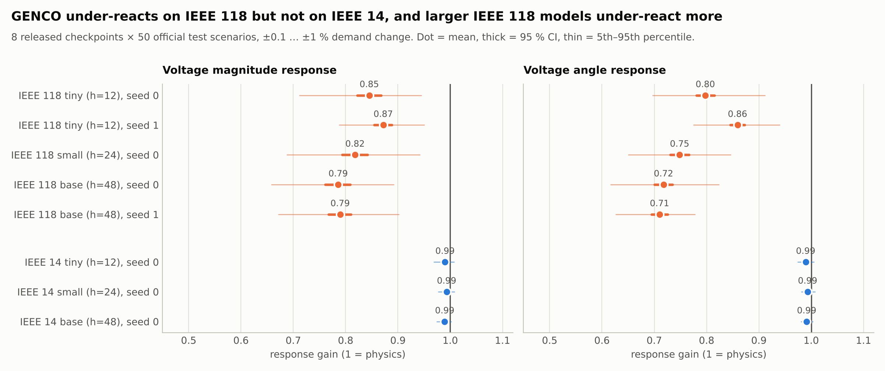

# GRID MIRAGE

**Same physics. Different representation. Different predictions?**

An entry to the [GridFM GENCO Challenge](https://huggingface.co/spaces/gridfm/genco-challenge): a **label-free acceptance test for grid foundation models**, run on **eight released GENCO power-flow checkpoints** ([`gridfm/genco-pf-datakit`](https://huggingface.co/gridfm/genco-pf-datakit): IEEE 14 and IEEE 118 × tiny/small/base, plus a second seed for IEEE 118 tiny/base). Each uses the official [GraphKit](https://github.com/gridfm/gridfm-graphkit) pipeline and 50 scenarios from its own official held-out test split. All results are real GENCO inference.

| Test | Question | Result |
|---|---|---|
| **Mirror** | Same grid, buses/generators/branches relabeled: same prediction? | **Yes, on all 8 checkpoints:** ≤2e-14 in float64; the float32 spread is summation-order round-off. |
| **Butterfly** | ±0.1…±1 % demand change: does GENCO respond like the physics? | **IEEE 14: yes** (gain 0.99–1.00). **IEEE 118: no**, every checkpoint under-reacts (gain 0.71–0.89), and **larger models under-react more** in both seeds. |
| **Physics Lens** | AC power-balance residual (only on quantities not enforced by construction) | Close to each checkpoint's published metric; grows away from the operating point. |
| **Hybrid check** | Is the bias correctable? One Newton–Raphson step from GENCO's prediction | **Yes:** gain 1.00 on every checkpoint (every case 0.98–1.02); residual ~200× lower. |





Per-checkpoint results (CSVs, summaries, Mirror and Butterfly figures, metadata with SHA-256 hashes) are in `results/genco_case{14,118}_{tiny,small,base}[_seed1]_n50/`; `results/genco_n50/` is IEEE 118 base, seed 0. The cross-checkpoint table is `results/checkpoints.md`.

The full method, numbers and limitations are in **[TECHNICAL_REPORT.md](TECHNICAL_REPORT.md)**.

## Repository

| Path | Content |
|---|---|
| `src/genco_mirage.py` | Runs real GENCO inference on relabeled and load-perturbed scenarios, plus the AC reference and Physics Lens |
| `src/acgrid.py` | Independent AC Newton–Raphson, Y-bus from GraphKit edge admittances, nodal residuals, consistent relabeling (numpy only) |
| `src/fetch_genco_inputs.py` | Downloads the 8 checkpoints, the IEEE 14 dataset and only the needed IEEE 118 partitions (~1.3 GB instead of 4 GB) |
| `src/summarize_genco.py`, `src/plot_genco.py` | Summary tables with bootstrap CIs, and figures |
| `src/hybrid_mirage.py` | GENCO + 1–2 Newton–Raphson steps: Butterfly/Physics Lens re-test and headline figure |
| `src/plot_schematic.py` | Workflow schematic (figure 1) |
| `src/compare_checkpoints.py`, `run_all_checkpoints.sh` | Cross-checkpoint table/figure; reproduce all 8 runs |
| `src/figstyle.py` | Shared figure style |
| `src/compare_genco.py` | Generic equivariance/sensitivity metric on exported prediction arrays |
| `src/ac_reference_mirage.py` | Mirror/Butterfly on the AC reference itself (IEEE 118 via pandapower), as a measurement floor |
| `results/genco_n50/`, `results/genco_pilot8/` | Raw CSVs, summaries, figures, run metadata (scenario IDs, SHA-256 of checkpoint/config/stats, GraphKit commit), `pip freeze` |
| `tests/` | Unit tests: relabeling preserves physics, reference vs pandapower, harness checks |

## Reproduce

```bash
python3.12 -m venv .venv && source .venv/bin/activate
pip install torch==2.8.0 torch_geometric pyarrow pytest matplotlib huggingface_hub pandapower
FORCE_CUDA=0 pip install --no-build-isolation torch-scatter
git clone --branch genco-paper-repro https://github.com/gridfm/gridfm-graphkit external-genco/gridfm-graphkit
pip install -e external-genco/gridfm-graphkit           # tested at commit 4e7fbcf
python src/fetch_genco_inputs.py --dest external-genco  # scenarios recorded in results/*/metadata.json
bash run_all_checkpoints.sh                              # all 8 checkpoints + comparison, < 2 h on 4 CPUs
```

The 8-scenario pilot: `NUM_SAMPLES=8 OUT=results/genco_pilot8 bash run_genco_mirage.sh`.

## License

Apache-2.0 (see `LICENSE`), the same as GraphKit.

## Contact

Peder Falkman, CEO, Solid Soup — peder@blas.se — [LinkedIn](https://www.linkedin.com/in/peder-falkman-814733b0/)
