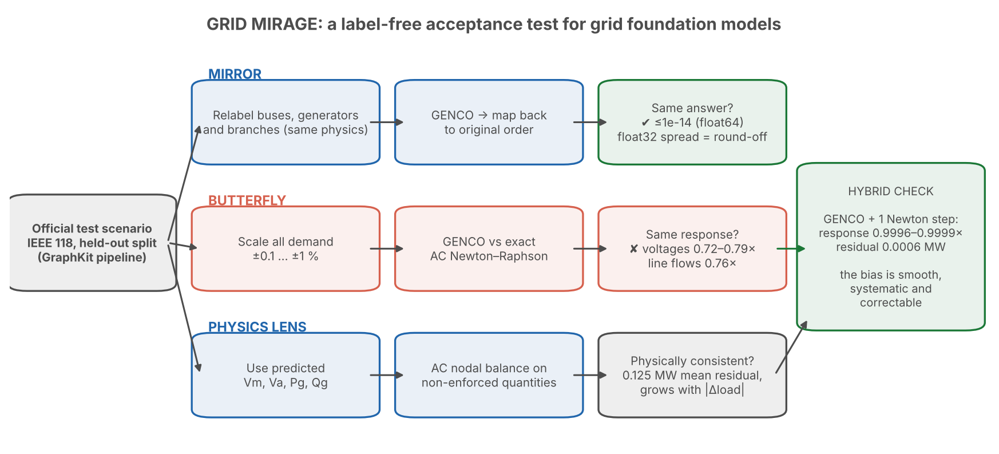

# GRID MIRAGE — technical report (October 2026)

**Same physics. Different representation. Different predictions?**
Pretrained GENCO PF checkpoint `gridfm/genco-pf-datakit` · `case118_ieee/base/seed0` · executed on CPU (4 vCPU cloud container, no GPU). All GENCO numbers below come from `results/genco_n50/` (main run, 50 test scenarios) and `results/genco_pilot8/` (independent pilot, 8 different test scenarios). Both were produced by `src/genco_mirage.py`. Nothing is simulated.

## 1. Findings

1. **Mirror: GENCO is permutation-equivariant.** Consistent relabelings of buses, generators and branches give 50 scenarios × 7 load levels × 5 relabelings = 1,750 comparisons per precision. In float64 they change predictions by at most **9.3e-15 p.u. (Vm), 1.2e-14 rad (Va), 1.1e-11 MW (Pg), 6.0e-11 Mvar (Qg)**. In deployed float32 the spread is **7.2e-6 p.u., 7.7e-6 rad, 6.5e-3 MW, 4.5e-2 Mvar**, caused entirely by floating-point summation order:
   - inference is bit-repeatable (0.0 difference for identical input);
   - reordering only the edge list, with no bus relabeled, gives the same magnitude (3.2e-6 p.u., 3.9e-3 MW, 1.9e-2 Mvar).

   The float32 spread is 1–2 orders of magnitude below GENCO's error against the AC solution (mean Vm 1.0e-4 p.u., Pg 9.4e-2 MW, Qg 0.69 Mvar). This matches the architecture, which has no positional encodings and no bus-ID features (§3).
2. **Butterfly: GENCO's load response is systematically attenuated.** Under uniform ±0.1 %…±1 % demand changes, GENCO moves the state less than the independent AC Newton–Raphson solution of the same input:

   | Per-scenario gain (n = 50) | mean | 95 % CI of mean | p5–p95 | min–max | scenarios < 1 |
   |---|---|---|---|---|---|
   | Vm response (PQ buses) | **0.786** | [0.761, 0.809] | 0.658–0.892 | 0.489–0.926 | 50 / 50 |
   | Va response (non-slack buses) | **0.718** | [0.701, 0.735] | 0.617–0.823 | 0.587–0.843 | 50 / 50 |
   | Slack ΔPg, GENCO / reference | **0.800** | [0.786, 0.814] | 0.729–0.885 | 0.646–0.903 | 50 / 50 |

   The slack ratio is independent of the load step: 0.795 at −1 %, 0.800 at −0.1 %, 0.801 at +0.1 %, 0.805 at +1 %. So this is a linearized sensitivity bias, not an extrapolation artifact, and it is symmetric in sign. Line active-power flows respond with gain **0.762** (95 % CI 0.746–0.777, range 0.61–0.88). For lines whose true flow moves by more than 0.5 MW, the median line moves only 0.82× as far, and in a typical scenario at least 90 % of these lines move too little. No scenario reaches the physical response. The pilot, with 8 *different* test scenarios, gave 0.785 / 0.696 / 0.774, inside the same ranges.
3. **Physics Lens: power-balance error grows away from the dataset operating point.** Mean |ΔP| at PQ+PV buses at δ = 0 is **0.125 MW** (median over scenarios 0.095, 95 % CI of the mean [0.096, 0.163]). That interval contains the checkpoint's published test-set metric `Avg. active res. 0.106 MW`, which independently confirms that the pipeline reproduces the official evaluation. The mean rises to 0.137 MW at +1 % and 0.145 MW at −1 %. Mean |ΔQ| at PQ buses is 0.026 Mvar. The per-scenario maximum |ΔP| has median 0.36 MW and a heavy tail (one scenario reaches 6.0 MW). The AC reference residual is ≤ 6e-14 MW in every case.

4. **Hybrid fix: one Newton–Raphson step from GENCO restores exact physics.** Warm-starting a single AC Newton–Raphson step from GENCO's predicted voltages (same 50 scenarios × 7 load levels) gives:
   - response gain 0.786 → **0.9996** (Vm), 0.718 → **0.9998** (Va, range 0.991–1.001) and 0.762 → **0.9999** (line flows);
   - mean power-balance residual 0.13 MW → **6.3e-4 MW** (≈200× lower; max 6.5 → 0.49 MW);
   - with two steps, gain 1.0000 and residual 1e-7 MW.

   As an initializer, GENCO cuts full Newton–Raphson iterations to 1e-8 p.u. from 4.0 (flat start) to **2.1** on average (max 3). GENCO plus one physics step therefore gives physically exact sensitivities at the cost of a single linear solve. The same metamorphic test that exposed the bias certifies the fix (`src/hybrid_mirage.py`, `results/genco_n50/hybrid_summary.md`).

**Interpretation.** GENCO "sees through" the representational mirage: relabeling does not change its answer beyond float32 round-off. Its weakness is not representational but physical sensitivity. For a small, valid, physically consistent change in demand, it moves the state only about 72–80 % as far as the physics does, in every scenario tested. For uses that depend on sensitivities (what-if, contingency or load-growth screening), this bias matters more than its point accuracy suggests. The bias is cheap to remove: GENCO is an excellent *initializer*, and one Newton–Raphson step on top of it restores the physical response and power balance. That suggests a practical workflow: GENCO for speed, one physics step for trustworthy sensitivities, and Butterfly as the acceptance test.

## 1b. Relation to other challenge entries

* [GENCO-PTDF (#2)](https://huggingface.co/spaces/gridfm/genco-challenge/discussions/2) reports AC-PTDF sensitivity errors of about 10 % for the released IEEE 118 checkpoint and reduces them by response-supervised fine-tuning. Butterfly is complementary: it measures the *direction* of the sensitivity error under a system-wide load change (a consistent attenuation), without labels or training.
* [Anchored screening (#8)](https://huggingface.co/spaces/gridfm/genco-challenge/discussions/8) finds GENCO's errors largely systematic and starts Newton from GENCO's predicted change. Our gain shows that this predicted change is itself 20–28 % too small, consistent with their need for a Newton step after anchoring. GENCO + Newton hybrids appear in several entries (#8, #17, #19, #25), so our hybrid check is a diagnostic (the bias is correctable), not a claimed new method.
* No other entry (24 at the time of writing) tests representation equivariance, which is what Mirror adds.

## 2. Experimental design

* **Model:** GraphKit `genco-paper-repro` @ `4e7fbcf6aa33c09b5ec9f15e5952dbbff004b74e`, loaded through GraphKit's own `NestedNamespace`, `load_normalizer` + `fit_from_dict(normalizer_stats)`, `get_task`, `adapt_state_dict_for_model` and strict `load_state_dict`. Eval mode, `torch.use_deterministic_algorithms(True)`, CPU, 4 threads. SHA-256: checkpoint `3ea2f552…ab065`, stats `01c93104…68411`, config `18255b52…da98` (full hashes in `metadata.json`).
* **Data:** `gridfm/pf_small_case118_ieee` @ `3f5a6e26…` (219,103 scenarios with perturbed loads, admittances and N-1 topologies). The official seed-0 subset and `split_by_load_scenario_idx` test split were replicated with GraphKit's own split function (test split: 21,908 scenarios, never used in training). 50 test scenarios were drawn with seed 2026; the scenario IDs are in `results/genco_n50/metadata.json`. The pilot's 8 scenarios are a separate draw. Each scenario is built with GraphKit's `build_hetero_data_for_scenario` and passed through the official normalizer and `PowerFlow` transforms (inactive-element removal, PF masks).
* **Mirror:** each relabeling applies random permutations to bus rows (features and labels), generator rows, gen↔bus edges, and branch-edge order with attributes and targets. Outputs are mapped back to canonical order before comparison. Unit tests confirm each relabeled sample is the same physical grid (AC solution identical to 1e-9).
* **Butterfly:** Pd and Qd at every bus × (1 + δ), δ ∈ {−1, −0.5, −0.1, 0, +0.1, +0.5, +1} %, with generator set-points and voltages unchanged and the slack absorbing the change. This is a valid PF input. *Response gain* = ⟨Δy_GENCO, Δy_ref⟩ / ⟨Δy_ref, Δy_ref⟩ over PQ buses (Vm) or non-slack buses (Va), averaged over the six non-zero δ per scenario. Confidence intervals are from a bootstrap over scenarios (10,000 resamples).
* **AC reference** (`src/acgrid.py`, independent code): polar Newton–Raphson on the scenario's own admittances (Yff/Yft/Ytt/Ytf), shunts and set-points. It is validated twice: against pandapower on IEEE 118 (≤ 2e-14), and against the dataset's own AC labels for every scenario used (≤ 5.6e-7 p.u., limited by GraphKit's float32 storage; ≤ 5e-11 in float64 directly from parquet). All 58 scenarios passed the validity gate (`accuracy.csv: reference_validated`).
* **Hybrid:** GENCO's float32 Vm/Va (original representation) is the warm start for the same Newton–Raphson solver, with a fixed 1 or 2 steps, or run to 1e-8 p.u. to count iterations. Power balance is evaluated against the *specified* injections (PV set-points, zero generation at PQ buses), so the residual is not trivially zero.
* **Physics Lens:** AC nodal balance using the predicted Vm, Va, Pg and Qg and the scenario's admittances. GENCO's PF decoder computes slack-bus Pg and PV/slack-bus Qg from the predicted voltages, so those residuals are zero by construction (confirmed: ≤ 1.9e-4 MW, float32) and are excluded. Reported residuals are **P at PQ+PV buses and Q at PQ buses**.

## 3. Model facts relevant to the test (from GraphKit source)

`GNS_heterogeneous`: 12 × `HeteroConv(TransformerConv)` (hidden 48, 8 heads) over bus–bus, gen→bus and bus→gen relations, with per-node MLPs and LayerNorm, scatter-sum aggregation and per-layer physics-residual feedback. There are no positional encodings or node-ID features, so equivariance is expected by construction. The Mirror test confirms that the released checkpoint plus the official preprocessing preserve it in practice: no index-dependent step (sorting, masking, normalization, inactive-element compaction) breaks it.

## 4. Results tables (main run, n = 50; from `results/genco_n50/summary.md`)

| Channel | float32 max | float32 mean | float64 max | GENCO vs dataset mean abs (δ=0) |
|---|---|---|---|---|
| Vm [p.u.] | 7.15e-06 | 8.47e-08 | 9.33e-15 | 1.04e-04 |
| Va [rad] | 7.69e-06 | 6.03e-07 | 1.24e-14 | 5.91e-03 |
| Pg [MW] | 6.47e-03 | 1.10e-05 | 1.11e-11 | 9.37e-02 |
| Qg [Mvar] | 4.51e-02 | 3.51e-04 | 5.98e-11 | 6.93e-01 |

| Load change | GENCO/ref slack ΔPg | P residual mean [MW] | P residual max [MW] | Q residual mean [Mvar] |
|---|---|---|---|---|
| −1.0 % | 0.795 | 0.145 | 5.521 | 0.0276 |
| −0.5 % | 0.798 | 0.132 | 5.853 | 0.0263 |
| −0.1 % | 0.800 | 0.126 | 5.992 | 0.0259 |
| 0 | — | 0.125 | 6.043 | 0.0259 |
| +0.1 % | 0.801 | 0.125 | 6.104 | 0.0259 |
| +0.5 % | 0.803 | 0.127 | 6.372 | 0.0264 |
| +1.0 % | 0.805 | 0.137 | 6.522 | 0.0274 |

Figures: `results/genco_n50/mirror.png`, `results/genco_n50/butterfly_physics.png`. The pilot (n = 8) figures and tables are in `results/genco_pilot8/`. The AC reference on the standard IEEE 118 case is `results/ac_reference/ac_reference.png`.




## 5. Limitations

* 50 + 8 scenarios out of a 21,908-scenario test split, with 5 relabelings each. The attenuation is present in every scenario and the CIs are tight, but this is a targeted sample, not a full benchmark.
* Butterfly uses uniform proportional demand scaling with fixed generator set-points. Other perturbation directions (single-bus, generation re-dispatch) were not tested.
* The cause of the attenuation (e.g. smoothing from the regression objective) is not established here. Training data vary loads by far more than ±1 %, so the perturbation is not obviously out-of-distribution.
* One checkpoint (IEEE 118, base, seed 0). Other grids, seeds and the OPF models were not evaluated.
* Environment: CPU only. torch-scatter was built from source because prebuilt PyG wheels were unreachable. Full `pip freeze` is in each results directory.

## 6. Reproduce

```bash
python -m venv .venv && source .venv/bin/activate          # Python 3.12
pip install torch==2.8.0 torch_geometric pyarrow pytest matplotlib huggingface_hub
FORCE_CUDA=0 pip install --no-build-isolation torch-scatter
git clone --branch genco-paper-repro https://github.com/gridfm/gridfm-graphkit external-genco/gridfm-graphkit
pip install -e external-genco/gridfm-graphkit
python src/fetch_genco_inputs.py --dest external-genco     # checkpoint + bus_data + 58 needed partitions (~1 GB)
bash run_genco_mirage.sh                                   # tests + 50-scenario run + summary + figures (~11 min on 4 CPUs)
NUM_SAMPLES=8 OUT=results/genco_pilot8 bash run_genco_mirage.sh   # note: different draw size → different scenarios
python src/hybrid_mirage.py results/genco_n50 --raw-dir external-genco/data/case118_ieee/raw   # hybrid fix (~20 s)
python src/ac_reference_mirage.py                          # optional, needs pandapower
```

The pilot draw is reproduced exactly with `--scenario-ids 14318 21026 57182 72424 102727 118407 132454 209625`.

## 7. Practical note: evaluating a small subset

GraphKit's datamodule converts every raw scenario into a `.pt` file before applying `data.scenarios`, so a reduced YAML still processes all 219k scenarios. That needs far more RAM and disk than a small machine has. `src/genco_mirage.py` instead reads only the selected scenarios from parquet (row filter) and builds them with GraphKit's own `build_hetero_data_for_scenario`.

Independent work using only public GENCO / OpenGridFM resources and newly written code.
